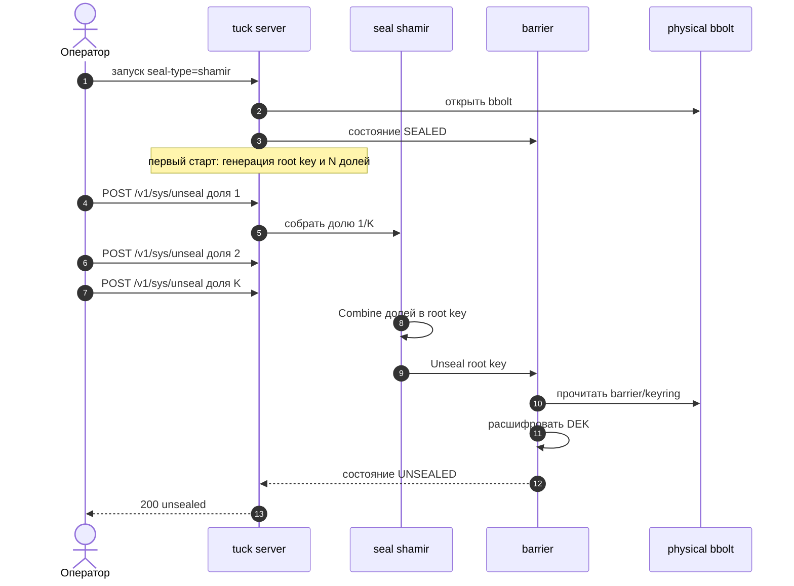
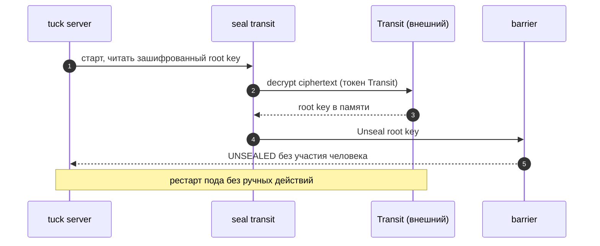
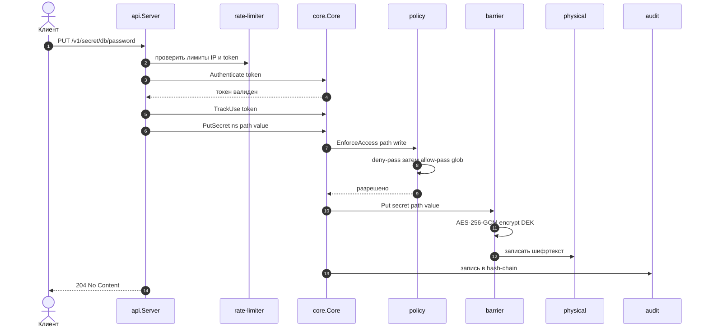
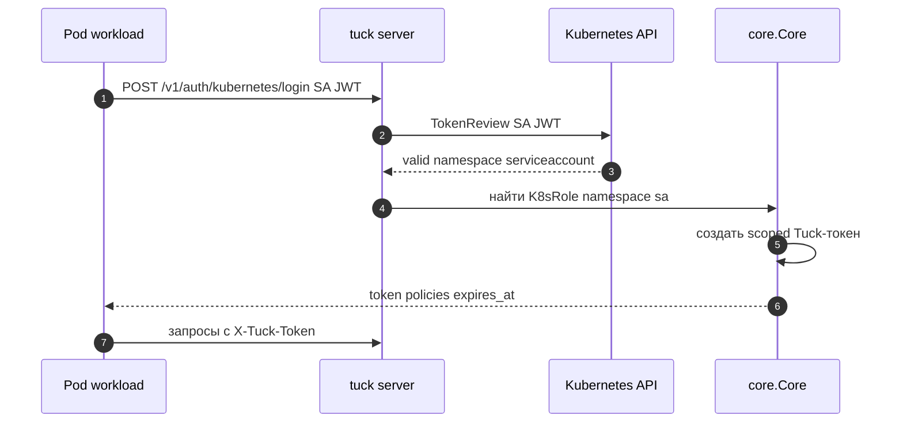
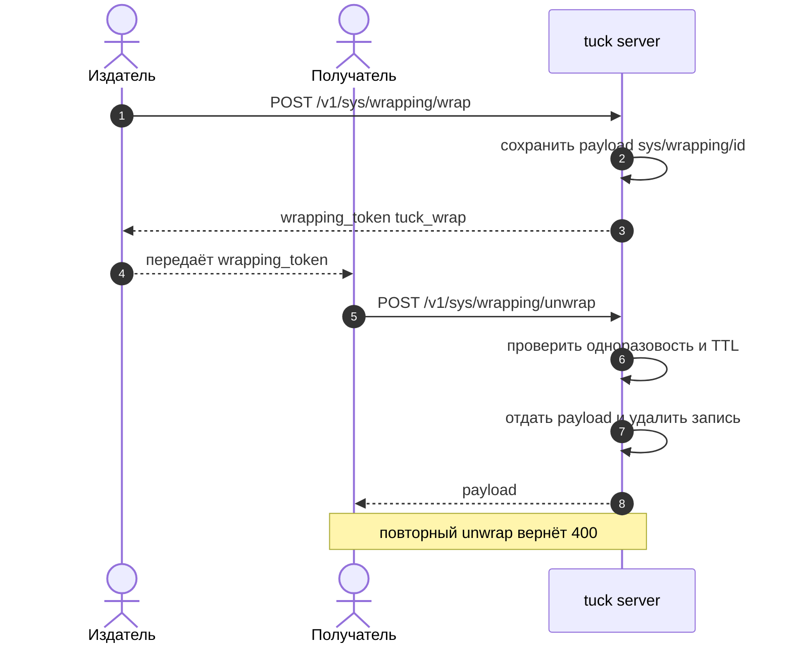
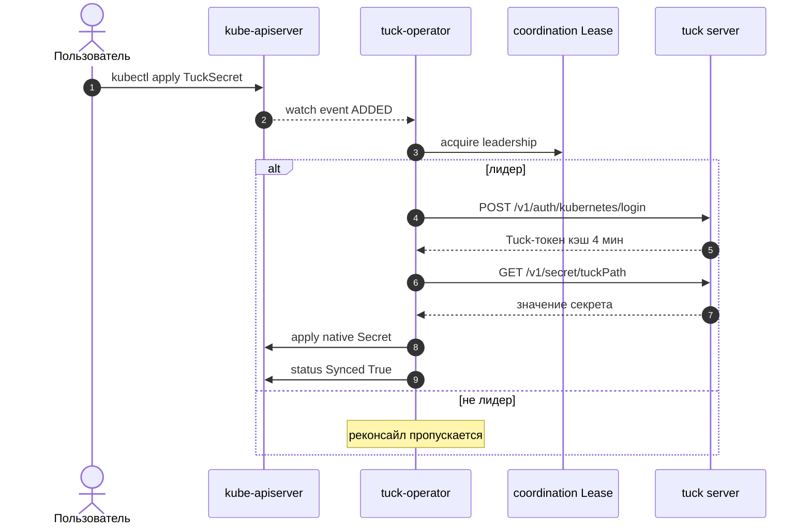
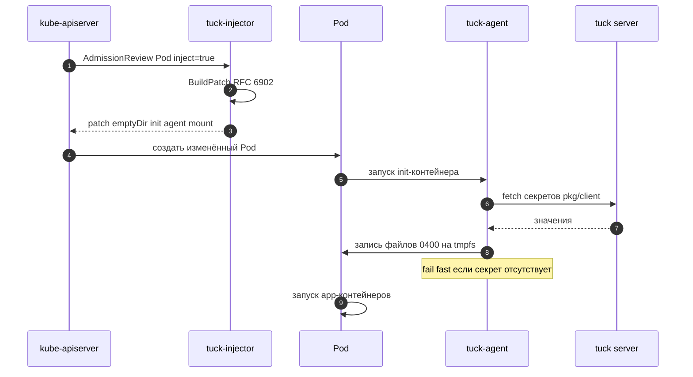
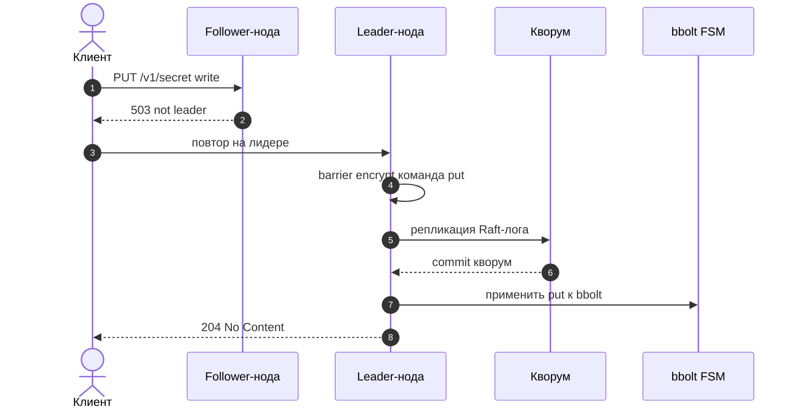

# 03 — Sequence-диаграммы ключевых сценариев

[← Назад: Архитектура](02-architecture.md) · [К оглавлению](README.md) · [Далее: API/CLI →](04-api-cli-reference.md)

Здесь — последовательности взаимодействия для наиболее важных потоков Tuck.

---

## 3.1. Запуск и распечатывание (Shamir)



---

## 3.2. Авто-распечатывание (Transit)



---

## 3.3. Запись и чтение KV-секрета (с проверкой ACL)



При чтении (`GET`) поток аналогичен, но capability — `read`, и барьер расшифровывает значение перед отдачей.

---

## 3.4. Аутентификация приложения через Kubernetes SA



---

## 3.5. Response Wrapping — безопасная передача секрета



---

## 3.6. Синхронизация TuckSecret оператором в K8s Secret



---

## 3.7. Webhook-инъекция секретов в Pod (минуя etcd)



---

## 3.8. HA-запись через Raft (forwarding на лидера)



---

## 3.9. Ротация root-ключа без простоя

```mermaid
sequenceDiagram
    autonumber
    actor Op as Оператор
    participant Tuck as tuck server
    participant Seal as seal
    participant Bar as barrier

    Op->>Tuck: POST /v1/sys/rotate
    Tuck->>Seal: сгенерировать новый root key
    Seal->>Bar: re-wrap DEK новым root key
    Bar->>Bar: обновить barrier/keyring
    Note over Seal: shamir новые доли; transit новый ciphertext
    Tuck-->>Op: 200 новые доли при shamir
```

---

[← Назад: Архитектура](02-architecture.md) · [К оглавлению](README.md) · [Далее: API/CLI →](04-api-cli-reference.md)
